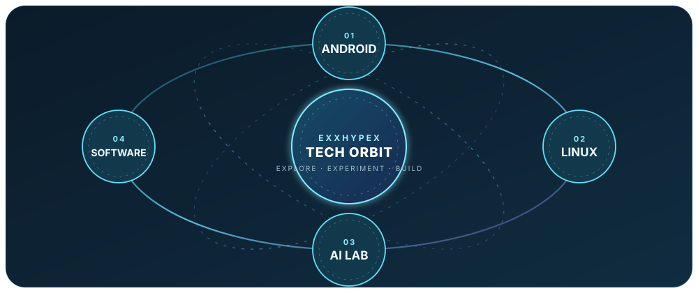

 

  

 

<a href="#about">ABOUT</a> &nbsp;·&nbsp; <a href="#ecosystem">ECOSYSTEM</a> &nbsp;·&nbsp; <a href="#work">PROJECTS</a> &nbsp;·&nbsp; <a href="#lab">CURRENT LAB</a> &nbsp;·&nbsp; <a href="#activity">ACTIVITY</a> &nbsp;·&nbsp; <a href="#connect">CONNECT</a>

  

&nbsp;

---

## 01 — Beyond the interface

I'm **EXXHYPEX** — an all-round technology enthusiast interested in understanding, experimenting with, and building technology.

My interests move between Android systems, Linux environments, developer tools, AI-assisted workflows, and open-source software.

I enjoy looking beneath the interface: exploring how systems work, testing ideas, and turning experiments into useful projects.

> **Explore thoughtfully. Experiment fearlessly. Build meaningfully.**

## 02 — My technology ecosystem

**Languages & foundations**

**Platforms & tools**

These icons represent technologies I explore and experiment with, not a claim of expert-level proficiency in every tool.

## 03 — Selected projects

A few things from my Android and developer-tooling workspace.

**HypZen** · Kotlin · Android

An Android flashing app experiment.

[Open repository](https://github.com/exxhypex/HypZen)

 

**Action Recovery Builder** · GitHub Actions · Android

A workflow project for building custom recoveries, including TWRP, OrangeFox, PBRP and SHRP.

[Open repository](https://github.com/exxhypex/Action-Recovery-Builder)

 

**Xiaomi Stone** · Android · Device tree

A TWRP device-tree project for the Redmi Note 12 5G (stone).

[Open repository](https://github.com/exxhypex/device_xiaomi_stone_twrp)

## 04 — Currently exploring

| Focus | What I'm exploring |
|:--|:--|
| Android systems | ROM customization, recovery builds and system internals |
| Mobile development | Android apps and mobile-first tools |
| Linux & automation | Termux, shell workflows and build automation |
| AI workflows | Agent-assisted development and creative tooling |

This is an evolving snapshot of my interests, not a list of finished products.

## 05 — GitHub activity

**Contribution overview**

  

**Contribution timeline**

 

## 06 — Connect

**Have an interesting idea, tool, or experiment?**

I'm always interested in discovering something new.

 

  

